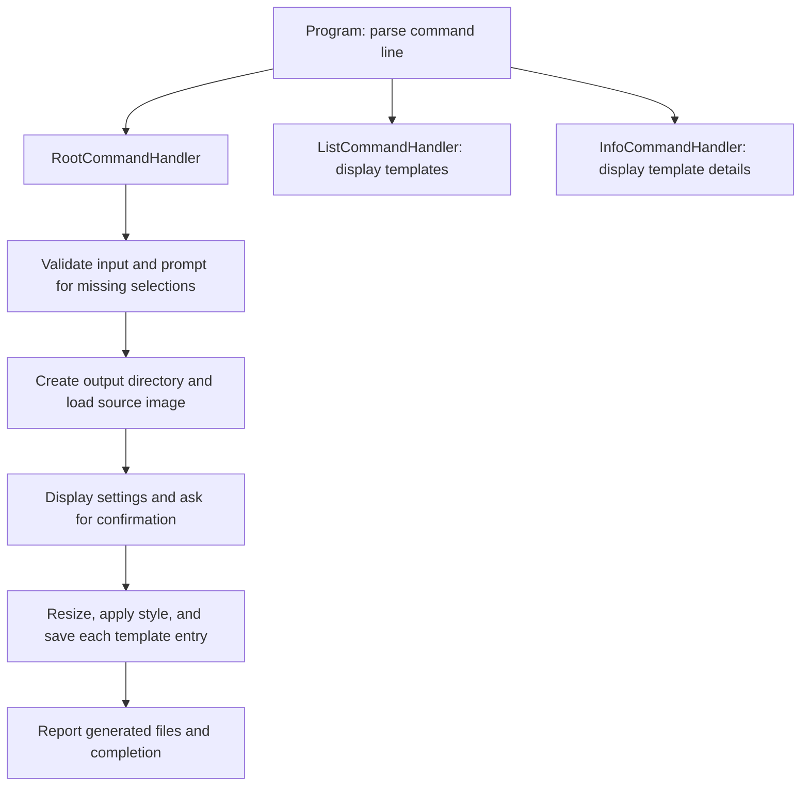

# Architecture overview

Icomatic is a .NET command-line tool that generates a set of icons from one local
image or HTTP/HTTPS image URL. Built-in templates define the output filenames,
dimensions, and formats. The user selects a template and a style, confirms the
planned output, and receives the generated files.

The solution contains the executable project, `Icomatic`, and the xUnit test
project, `Icomatic.Test`. Templates are defined in C#; there is no separate
template configuration file or database.

## Code structure

Paths below are relative to `Icomatic/`.

| Location | Responsibility |
| --- | --- |
| [`Program.cs`](../Icomatic/Program.cs) | Entry point, command definitions, dependency registration, and command dispatch. |
| [`Commands/`](../Icomatic/Commands) | Coordinates generation, template listing, and template details. Handlers share `ICommandHandler` and `BaseCommandHandler`. |
| [`Services/`](../Icomatic/Services) | Template lookup, icon generation, image style operations, and image downloading. Interfaces live in `Contracts/`. |
| [`Core/Domain/Models/`](../Icomatic/Core/Domain/Models) | Image wrapper, dimensions, supported formats, and icon styles. |
| [`Core/Domain/Templates/`](../Icomatic/Core/Domain/Templates) | Built-in template categories and their output definitions. |
| [`Core/Processing/`](../Icomatic/Core/Processing) | ImageMagick operations for rounded corners and circular masks. |
| [`Core/Validation/`](../Icomatic/Core/Validation) | Validates generation arguments, prompts for missing selections, and returns a validation result. |
| [`Infrastructure/`](../Icomatic/Infrastructure) | Console messages, interactive prompts, tables, and file trees, with interfaces in `Contracts/`. |
| [`Commons/`](../Icomatic/Commons) | Shared URL and enum display helpers. |

These folders separate responsibilities within the executable. They are not
separate assemblies: for example, validation uses console prompt interfaces, and
the domain image wrapper depends on ImageMagick.

## Command flow

`Program.Main` builds the dependency injection container, creates the commands
with System.CommandLine, and invokes the parsed command. Services are registered
as singletons; command handlers are constructed when their commands execute.



For the root command, the main steps are:

1. `IconGenerationValidator` checks the input file or URL, output directory
   argument, style, and template. If style or template is omitted, it uses
   `IUserPromptService` to ask the user. It returns the selected settings or an
   error through `IconGenerationValidationResult`.
2. `RootCommandHandler` creates the output directory if needed and gets the
   template entries from `ITemplateService`. Local files are loaded through
   `Image.Load`; URLs are downloaded through `IWebImageDownloadService` and
   converted to the domain `Image` wrapper.
3. `IConsoleUserInterface` displays the settings and planned filenames, then asks
   for confirmation. Directory creation and image loading happen before this step.
4. `IconGenerationService` iterates through the template entries. For each entry,
   it resizes the original source, applies the selected style, saves the result,
   and reports the generated path. Processing is sequential.

`list` displays available template names and descriptions in a table. `info
<template>` displays the template description and a tree of its output files.
Neither command loads or generates images. Successful commands return exit code
`0`; generation errors and user cancellation return `1`.

## Image and template behavior

- `TemplateDefinitions.TemplateInfo` holds a filename stem, a `Size`, and a
  `SupportedFormat`. Its `Filename` method adds an optional prefix and the format's
  default extension. `TemplateService` looks up templates by their case-sensitive
  display names.
- `Image` wraps `MagickImage` and implements `IDisposable`. Loading and creating
  image copies set the internal format to PNG. Resizing creates a new image with
  exact target dimensions, ignoring the source aspect ratio.
- `ImageProcessingService` selects the style. `plane` returns the supplied image;
  `round` and `circle` create new images using transparent masks in
  `ImageProcessor`. The circular mask preserves the image's dimensions.
- Plain icons are saved in the format specified by each template entry. Rounded
  and circular icons are saved as PNG to preserve transparency, while filenames
  still use the template's extension. SVG input is allowed, but SVG output is
  rejected by the explicit-format save method.
- Input validation checks file existence and extensions or URL shape. Decoding
  and network failures are handled later when the image is loaded. Directory
  validation only checks that a path was supplied.

## Dependencies and extension points

System.CommandLine handles parsing and dispatch. Microsoft.Extensions.DependencyInjection
provides service resolution, Magick.NET performs image operations, Sharprompt
provides interactive selections, and ConsoleTables renders tables. Publish settings
target self-contained, trimmed, single-file executables for Windows x64 and Linux x64.

Common changes usually start in these places:

- **Add a template:** add a category and its `TemplateInfo` entries in
  `TemplateDefinitions`, then include it in `GetAvailableTemplates()`.
- **Add a style:** update `IconStyle` and `ImageProcessingService.ApplyStyle`,
  implement the image operation, and review validation messages and output format
  handling in `IconGenerationService`.
- **Add a command or option:** define it in `Program`, add or update a command
  handler, and register any new services in `ConfigureServices`.
- **Change console presentation:** update the implementations under
  `Infrastructure/Console` and their contracts as needed.

Most services are accessed through interfaces. One current exception is
`IconGenerationService`, which constructs `ImageProcessingService` directly even
though `IImageProcessingService` is also registered in the container.

## Tests

`Icomatic.Test` references the executable project. The executable grants internal
access to this test assembly through `InternalsVisibleTo`, allowing tests to
exercise internal types without making them public.

- `ImageProcessingTests` checks exact resize dimensions, source preservation,
  transparent corners, centered circular masks on rectangular images, and
  preservation of existing transparency.
- `OutputDefinitionTests` checks extension recognition and format conversion,
  filename prefixes, and unique output filenames within each template.
- `IconGenerationValidatorTests` checks explicit options, prompting for omitted
  selections, and rejection of invalid styles and templates. A test implementation
  of `IUserPromptService` replaces interactive input.

Images are generated in memory. The URL used in validation tests is never
downloaded, so the tests require no external image assets or network access after
dependency restore. They do not exercise actual downloads or file generation.

Run the tests from the repository root:

```bash
dotnet test Icomatic.Test/Icomatic.Test.csproj
```

See the [README](../README.md) for build commands and usage examples. Shared method
documentation is primarily on interfaces, with implementations using
`<inheritdoc />`.
